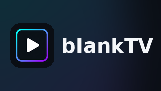

<p align="center">
  
</p>

<p align="center">
  <b>Tu propio reproductor IPTV para Android TV</b><br>
  <sub>Rápido · abierto · pensado para el mando a distancia — tú pones tus playlists M3U</sub>
</p>

<p align="center">
  
  
  
  
</p>

---

**blankTV** es un reproductor IPTV nativo para **Android TV**, escrito en Kotlin con Jetpack
Compose y Media3/ExoPlayer. Es *solo* un reproductor: **no incluye canales ni contenido**. Añades
tu propia playlist **M3U / M3U8** (por URL) y blankTV se encarga del resto.

> ⚠️ blankTV no distribuye canales, playlists ni streams. Eres responsable de las fuentes que
> añadas.

## ✨ Qué hace hoy (v0.1)

- **Tres tipos de fuente**:
  | Fuente | Protocolo |
  |---|---|
  | **M3U / M3U8** | documento único por HTTP, parseado en streaming |
  | **Xtream Codes** (xui.one y paneles similares) | `player_api.php`: auth, categorías, live/VOD/series + expansión de episodios |
  | **Stalker / MAG** (Ministra) | handshake por MAC → token, `get_all_channels`, géneros, VOD/series, normalización de `cmd` |
- **Import de playlists M3U/M3U8** por URL, parseadas en streaming (no se bufferizan enteras).
- **Live TV · Movies · Series** clasificados automáticamente a partir de la URL y el `group-title`.
- **Reproductor a pantalla completa** con HUD para TV: `DPAD_CENTER` pausa/reanuda,
  `CHANNEL_UP` / `CHANNEL_DOWN` hacen zapping, el HUD se oculta solo.
- **Favoritos** y **búsqueda** por título en toda la biblioteca.
- **Rail de navegación** con foco visible y escala, pensado para D-pad.
- **Tema oscuro / claro** persistido.
- **MediaSession**: las teclas de transporte del mando llegan al reproductor.

## 🧱 Stack

| Área | Elección |
|---|---|
| Lenguaje | Kotlin 2.0.21 |
| Build | AGP 8.7.2 · Gradle 8.9 · KSP 2.0.21-1.0.28 |
| UI | Jetpack Compose (BOM 2024.10.01) + Material3, manejo de foco TV propio |
| Media | Media3 / ExoPlayer 1.4.1 (HLS + DASH), OkHttp como data source |
| DB | Room 2.6.1 |
| Ajustes | DataStore Preferences |
| Mínimos | minSdk 24 · target/compile 35 · appId `app.blanktv.tv` |

## 🗂️ Estructura

```
app/src/main/java/app/blanktv/tv/
├── BlankTvApp.kt / MainActivity.kt
├── di/            AppContainer (grafo manual) + AppViewModelFactory
├── data/
│   ├── db/        Room: playlists (multifuente), channels, favourites
│   ├── net/       PlaylistFetcher (streaming)
│   ├── parser/    M3uParser (+ tests)
│   ├── xtream/    XtreamClient + XtreamUrls (player_api.php) (+ tests)
│   ├── stalker/   StalkerClient + StalkerCmd (Ministra/MAG) (+ tests)
│   └── repo/      LibraryRepository, SettingsRepository
├── domain/        MediaKind
├── player/        PlaybackController, MediaSessionService
├── view/          LibraryViewModel, PlayerViewModel
├── ui/            tema, componentes (FocusBox, Cards, States), Shell, NavHost
└── features/      home, live, catalogue, favourites, search, settings, player
```

## 🛠️ Compilar

Requisitos: JDK 17 y Android SDK 35 (Android Studio reciente los aporta).

```bash
./gradlew :app:assembleDebug      # APK en app/build/outputs/apk/debug/
./gradlew :app:testDebugUnitTest  # tests del parser M3U
```

Instala en un emulador/TV con Android 7.0+ (API 24). Añade una playlist desde
**Settings → Add playlist**.

> Nota: este proyecto se escribió en un entorno sin Android SDK, así que el **primer build verde
> es el hito v0.2**. Detalles y siguientes pasos en [`docs/ROADMAP.md`](docs/ROADMAP.md).

## 📚 Documentos

- [`docs/ANALISIS_OWNTV.md`](docs/ANALISIS_OWNTV.md) — análisis de arquitectura de OwnTV y qué
  decisiones inspiraron blankTV.
- [`docs/ROADMAP.md`](docs/ROADMAP.md) — hojas de ruta v0.2 → v0.5.
- [`third_party/README.md`](third_party/README.md) — código de terceros vendado (OwnTV_Core,
  GPL-3.0, solo lectura, no se compila).
- [`NOTICE.md`](NOTICE.md) — licencia, composición del repo y atribución.

## ⚖️ Licencia

GPL-3.0 — ver [`LICENSE`](LICENSE). Atribución y relación con OwnTV en [`NOTICE.md`](NOTICE.md).

La marca blankTV (ícono, banner, wordmark) es original de este proyecto; se regenera con
`python3 brand/make_assets.py` a partir de `brand/logo_master.png`.
